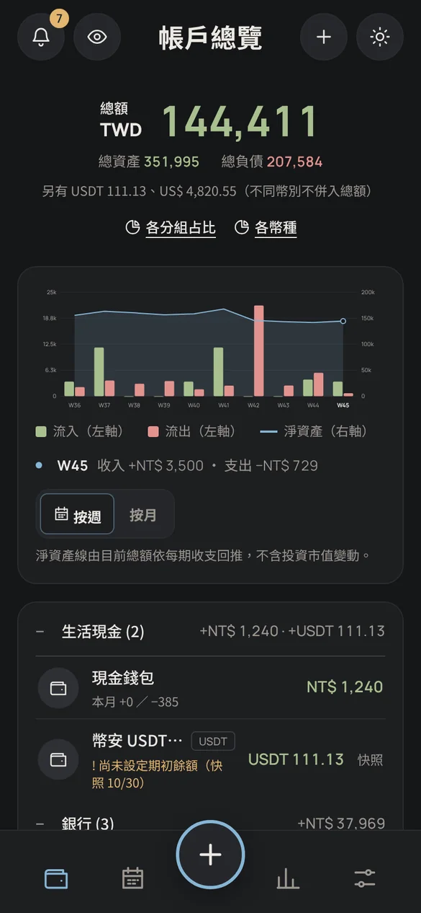
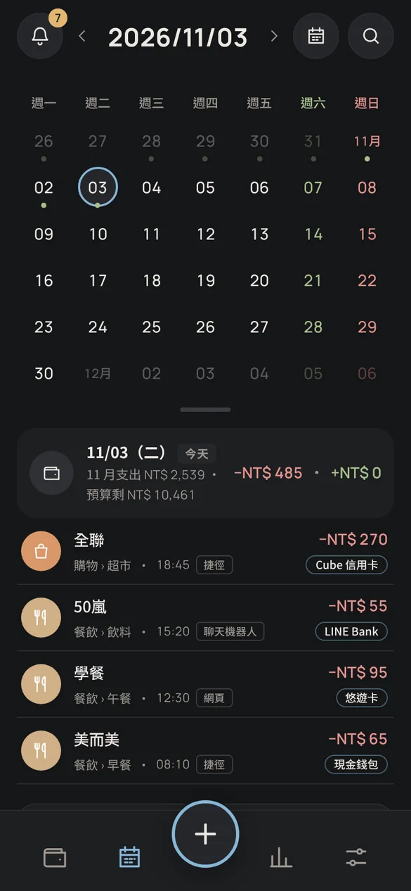
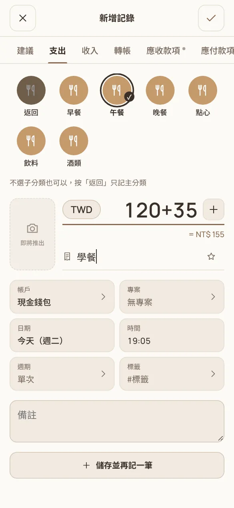
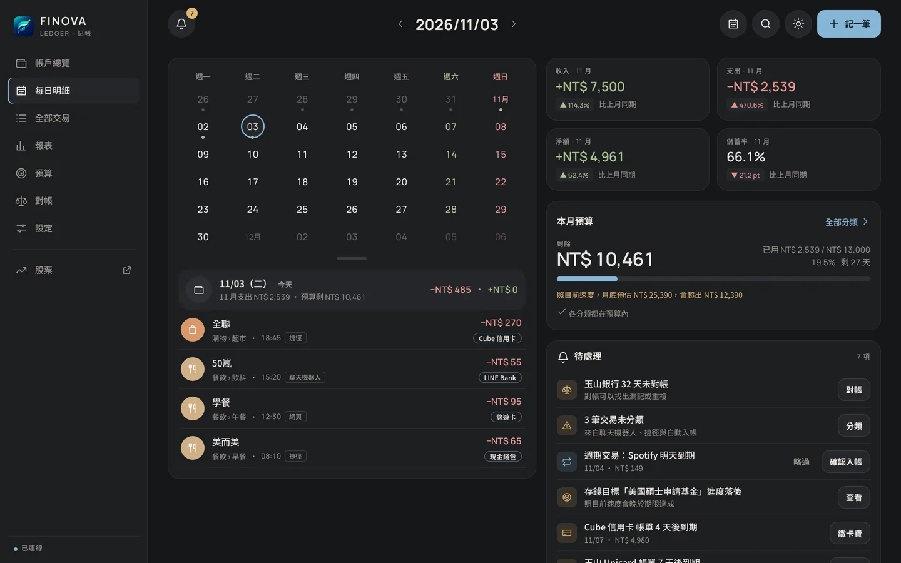
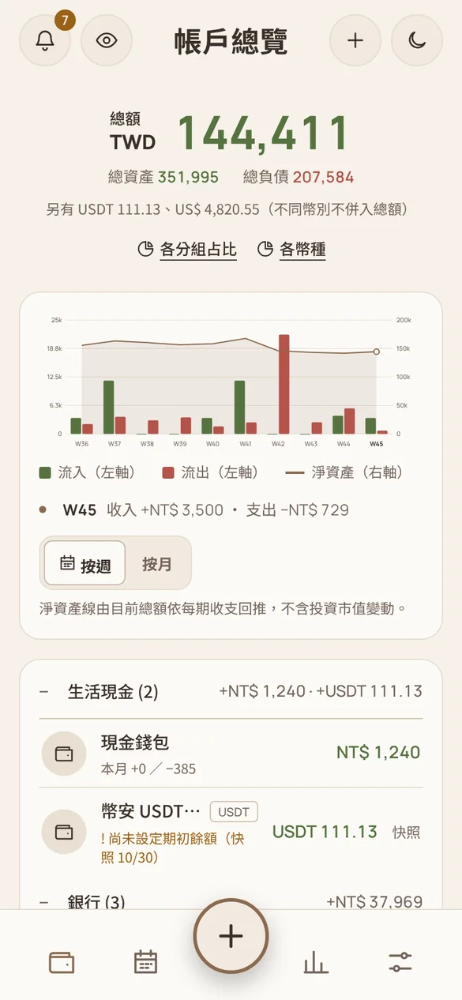
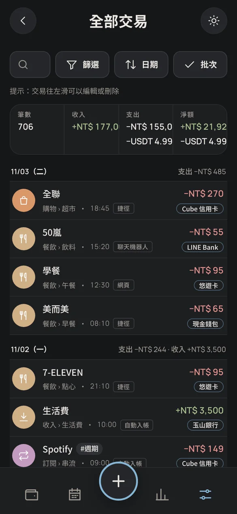
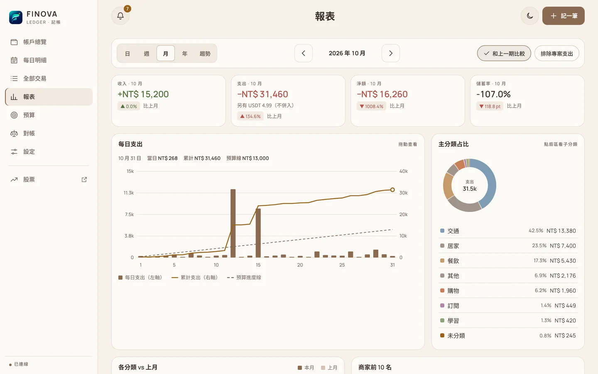
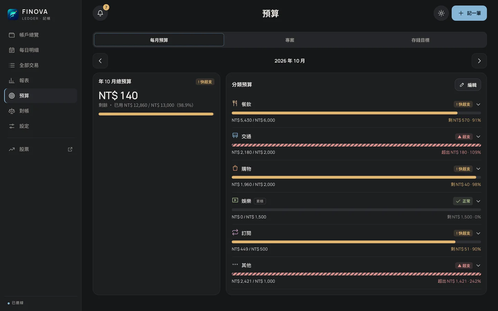
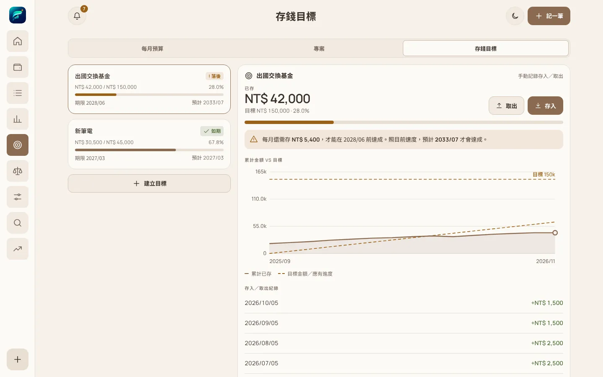
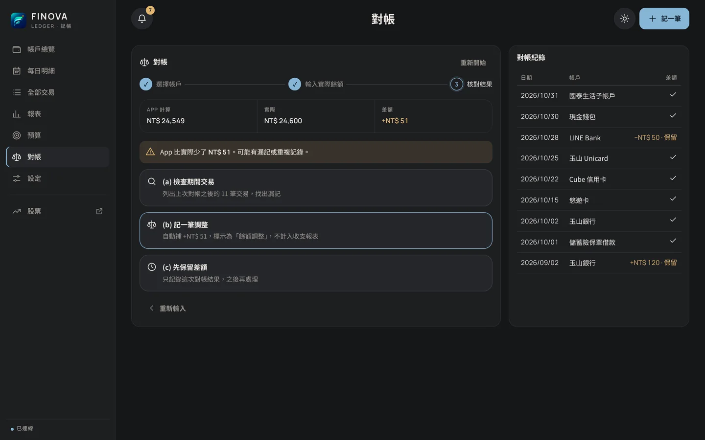

<p align="center"></p>

<h1 align="center">Finova 記帳</h1>

<p align="center">給學生與小資族的個人記帳 App：帳戶總覽、每日明細、報表、預算、存錢目標與對帳，深色／淺色主題，手機與桌面都能用。</p>

<p align="center">
  
  
  
</p>

<p align="center"></p>

---

## 使用者介紹

### 誰適合用

- 有好幾個帳戶要管：現金、銀行、LINE Bank、悠遊卡、信用卡，甚至 USDT 或美股帳戶。
- 想知道錢花去哪裡、這個月還能花多少。
- 用 iPhone 捷徑、聊天機器人或從 MOZE 匯入記帳，需要一個地方把所有紀錄看清楚、改正確。

### 畫面導覽

手機底部有五個按鈕（桌面版在左側選單）：

| 按鈕 | 頁面 | 做什麼 |
|---|---|---|
| 錢包 | **帳戶總覽**（首頁） | 淨資產總額、總資產／總負債、每週或每月收支圖、各帳戶餘額 |
| 月曆 | **每日明細** | 點月曆上的日期看當天紀錄；下方是本月收支、預算、待處理事項 |
| ＋ | **記一筆** | 支出、收入或轉帳 |
| 長條圖 | **報表** | 日、週、月、年報表與分類趨勢 |
| 齒輪 | **更多** | 全部交易、預算、對帳、設定 |

### 帳戶總覽



- 最上面的大數字是 **新台幣淨資產**（現金＋投資 − 信用卡 − 負債）。USDT、美元等其他幣別另外列出，**不會換算或加總**。
- 👁 按鈕可以一鍵模糊所有金額，在公共場合打開 App 也不怕被看到。
- 「各分組占比」「各幣種」可以看資產分布。
- 帳戶依類型分組，可收合。信用卡顯示「欠款」與繳款倒數，太久沒對帳的帳戶會標橘色提醒。
- 點任何帳戶進入詳情：餘額走勢、對帳點、最近明細；信用卡還有本期帳單與「繳卡費」按鈕。

<br clear="right">

### 記一筆

1. 按下方 **＋**（桌面版右上「記一筆」）。
2. 選 **支出／收入／轉帳**，用數字鍵盤輸入金額。
3. 點「常用」快速選分類，或從主分類 › 子分類挑選（只選主分類也可以）。
4. 選帳戶、日期；商家欄打幾個字會跳出以前記過的商家，選了自動帶入分類和帳戶。
5. 按 **儲存**；要連續記好幾筆就按 **再記一筆**。

- 存完畫面下方會出現「復原」，記錯可以馬上撤回。
- 轉帳到信用卡會自動記成「繳卡費」；跨幣別轉帳（例如台幣換 USDT）要填轉入金額。
- 交易列 **往左滑** 可以編輯或刪除；刪除的紀錄 30 天內可在「設定 › 最近刪除」復原。

### 每日明細與全部交易



- 月曆上有小圓點的日期代表有紀錄，點日期看當天明細；拉下方的橫條可以收合成一週。
- 「待處理」會提醒：多久沒對帳、未分類的交易、即將到期的週期扣款與信用卡帳單、預算快用完。
- **全部交易** 可以搜尋商家與備註，用篩選選日期、類型、帳戶、分類、來源、標籤、金額範圍。
- 按 **批次** 一次修改多筆的分類、帳戶、標籤、專案，或一次刪除。
- 桌面版可以把篩選結果 **匯出 CSV**。

<br clear="right">

### 報表

<p></p>

- **月報**：收入、支出、淨額、儲蓄率與上月比較；每日支出圖（可拖動看當天數字）、分類占比（點扇區看子分類）、商家前 10 名、預算達成、固定 vs 變動支出。
- 「排除專案支出」可以把旅行等專案花費拿掉，看日常開銷。
- **年報**：每月收支、各分類每月組成、月平均與最高／最低月份。
- **趨勢**：選一個分類或商家，看每日／每週／每月的花費變化。

### 預算、專案、存錢目標

<p></p>

- **每月預算**：設定月總預算和各分類上限。用到 80% 變橘色、超過變紅色條紋；也會依目前速度推估月底花費。第一次使用可以「用過去 3 個月平均快速建立」。
- **專案**：旅行或活動可以獨立設預算（可同時有台幣和日圓預算），看已花、剩餘、每日可用。
- **存錢目標**：設定目標金額與期限，記錄存入／取出，App 會算出每月還要存多少、預計哪個月達成。

<p></p>

### 對帳

<p></p>

1. 選帳戶，輸入銀行 App 上看到的實際餘額（信用卡請填目前欠款）。
2. App 比對計算出的餘額，告訴你差多少。
3. 有差額時可以：檢查上次對帳後的交易找漏記、記一筆「餘額調整」（不計入收支），或先保留差額之後再處理。

### 離線與同步

- 沒有網路時仍然可以記帳，紀錄會標「待同步」，連上網路後自動送出。
- 離線時可以看最近一次載入的資料；編輯、刪除和對帳要等連線後再做。
- 登入過期時，填到一半的表單會自動暫存，重新登入後還原。

### 加到 iPhone 主畫面

用 Safari 開啟 `/finance`，按「分享 › 加入主畫面」，就會出現 Finova 圖示，開啟後直接進入帳戶總覽，像一般 App 一樣全螢幕使用。

- 主畫面 App 沒有瀏覽器的重新整理按鈕：在帳戶總覽、每日明細、全部交易頁 **往下拉** 就能更新。
- 主畫面 App 和 Safari 不共用登入狀態，第一次從圖示開啟時要再登入一次。

---

# 開發者說明

依 **FRONTEND-CONTRACT v1.0（凍結版）** 開發。頁面在 `/finance`，只呼叫 `/api/ledger/*`；後端完成前用 `mocks/` 的 mock API 開發。

## 開始

```bash
npm install
npm run dev          # http://localhost:5173/finance/ ，使用 mock API
npm test             # mock 資料與契約行為的測試
npm run typecheck
```

接真實後端：

```bash
VITE_API_TARGET=https://你的網站 npm run dev:api   # 不載入 mock，/api 轉送到後端
npm run build                                    # 正式版輸出到 dist/（不含 mock）
```

部署到財富儀表板的 `/finance`（路由衝突、SPA fallback、service worker scope、快取標頭、Cloudflare Access、上線與回滾）請看 **[docs/DEPLOY.md](docs/DEPLOY.md)**。後端 `/api/ledger/*` 上線前不要切換正式的 `/finance`。

和 FRONTEND-CONTRACT v1.0 刻意不同的地方（App 首頁改成帳戶總覽、`start_url`）記在 [docs/CONTRACT-CHANGES.md](docs/CONTRACT-CHANGES.md)，待併入契約 v1.1。

## 目錄

| 路徑 | 內容 |
|---|---|
| `src/types/ledger.ts` | 契約 §1–§4 的型別，**原樣複製**，前後端共用的正式來源 |
| `src/api/client.ts` | 回應信封、錯誤碼、503 自動重試 2 次、登入過期偵測（401／被導向／收到 HTML） |
| `src/api/ledger.ts` | 每個端點的型別化函式（契約 §3、§4） |
| `src/api/offline.ts` | 離線新增佇列（IndexedDB）與同步 |
| `src/lib/money.ts` | 金額字串的十進位運算（BigInt）與顯示格式；不同幣別絕不相加 |
| `src/lib/dates.ts` | Asia/Taipei 時區、週一開始、ISO 週 |
| `src/views/*` | 各頁面 |
| `src/ui/entry.ts` | ＋ 記一筆／編輯表單 |
| `public/sw.js` | Service worker：離線時讀快取（catalog、overview、最近一頁明細） |
| `public/logo-*.png`、`apple-touch-icon.png`、`icon-maskable-*.png` | App 圖示（一般／iOS／Android 自適應） |
| `src/ui/ptr.ts` | 主畫面 App 的下拉更新 |
| `deploy/` | 掛到 Next.js（`next-finance.mjs`）或 nginx（`nginx-finance.conf`）的設定範例 |
| `docs/` | 部署說明、契約修訂提案、README 用的 logo 與截圖 |
| `mocks/fixtures/*.json` | DESIGN-BRIEF §8 的假資料，加上契約 §7 要求的情境 |
| `mocks/db.ts`、`mocks/handlers.ts` | 記憶體資料庫、各端點實作 |
| `mocks/browser.ts` | 在瀏覽器攔截 `fetch('/api/ledger/*')`、模擬錯誤 |

## 契約對照

| 契約 | 前端做法 |
|---|---|
| §1.2 金額是字串 | 顯示一律由 `lib/money` 格式化；加總、相減、平均都用 BigInt 十進位（`add`、`sub`、`sumByCurrency`、`div`）；多幣別分開列出；`num()` 轉成浮點數只用在圖表比例 |
| §1.5 冪等 | 開表單時產生 `web:<uuid>`，重送與離線佇列沿用同一把；`duplicate` 視同成功；`IDEMPOTENCY_CONFLICT` 會先問你，再決定是否當成新的一筆 |
| §1.6 樂觀鎖 | PATCH／DELETE 帶 `expected_version`；`VERSION_CONFLICT` 時顯示 `error.current` 的最新內容並提供「重新載入」 |
| §2.1 catalog | 啟動時載入、快取 5 分鐘；遇到 `UNKNOWN_*` 錯誤時強制重新載入。分類、帳戶、標籤、常用項目都來自 catalog，前端沒有寫死 |
| §2.3 符號約定 | 信用卡、負債的負數餘額顯示成「欠款 NT$ 6,354」 |
| §5 錯誤碼 | `details` 顯示在對應欄位旁；503 自動重試 2 次（同一把 key），仍失敗時顯示重試按鈕 |
| §6 登入過期 | 表單存到 sessionStorage，顯示「重新登入」，導向 `/cdn-cgi/access/login?redirect_url=…`；回來後自動還原 |
| §6 離線 | 新增進佇列並標「待同步」；`online`、回到前景或按「同步」時依序送出；4xx 留在佇列等你修正；編輯、刪除、對帳在離線時停用 |
| §8 路由 | `/finance`、`/transactions`（篩選放在 query，名稱和 API 參數相同）、`/transactions/:id`、`/new?type=`、`/accounts[/:key]`、`/reports/daily…trend`、`/budgets`、`/projects[/:id]`、`/goals[/:id]`、`/reconcile?account=`、`/settings/*` |

## Mock 錯誤模擬

在「設定 › 開發用 Mock」切換，或在網址加 `?mock=<情境>`：

| 情境 | 效果 |
|---|---|
| `validation` | 下一次寫入回 `VALIDATION_ERROR`，附欄位錯誤 |
| `version` | 下一次修改或刪除回 `VERSION_CONFLICT`（模擬別處先改過） |
| `idempotency` | 下一次新增回 `IDEMPOTENCY_CONFLICT` |
| `auth` | 下一個請求被導向登入頁（HTML）→ `AUTH_EXPIRED` |
| `busy` | 寫入先回 503 兩次後成功（看自動重試） |
| `down` | 寫入一律回 503（看重試按鈕） |
| `offline` | 模擬離線 |
| `slow` | 每個請求延遲 1.2 秒 |

Mock 的「今天」固定是 2026-11-03，和 DESIGN-BRIEF 的假資料一致。1–10 月的歷史交易由 `mocks/db.ts` 依 `history.json` 決定性產生，所以每次重新整理數字都相同；重新整理也會把 mock 資料還原。

## 單檔預覽版

```bash
npm run build:preview   # dist-preview/finova-preview.html：含 mock、記憶體路由，可直接開啟或分享
```
